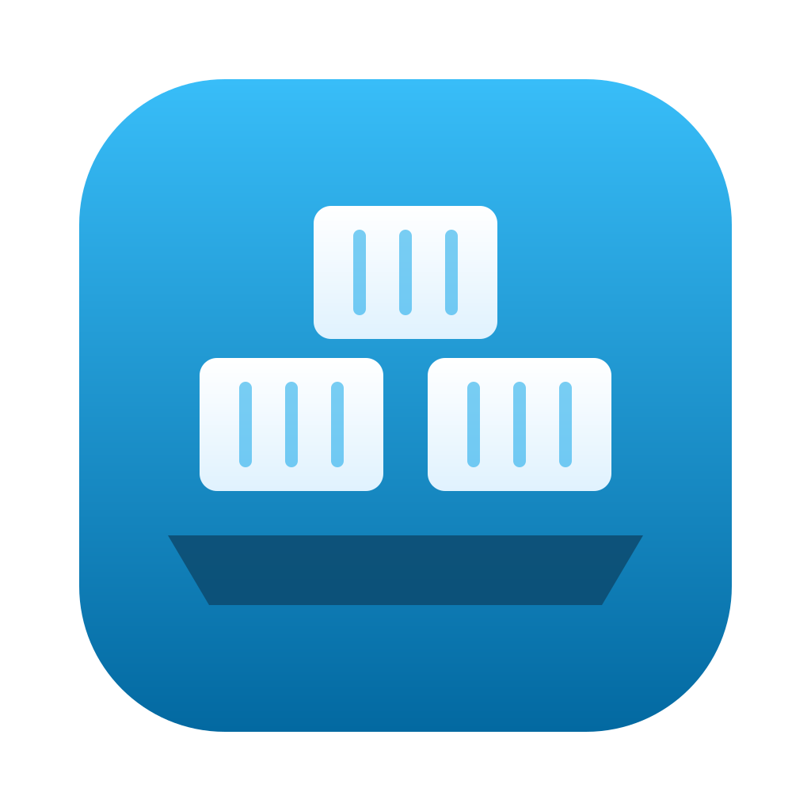
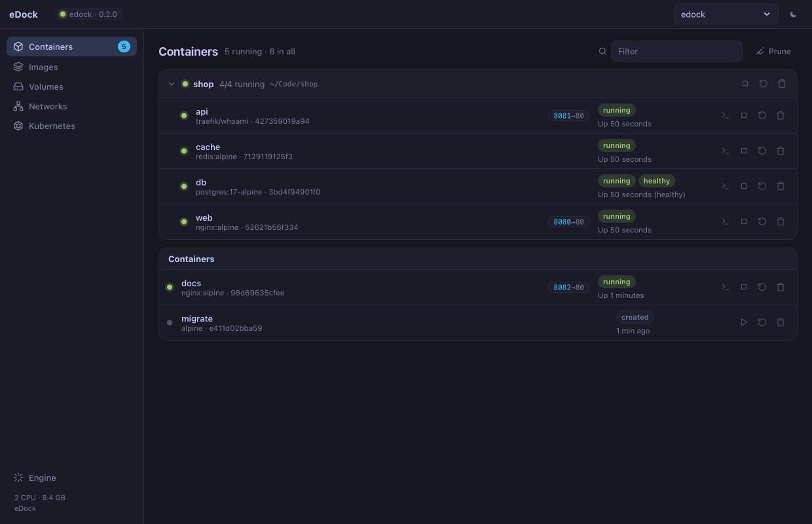

<div align="center">



# eDock

**A tiny, fast container runtime for the Mac.**

eDock runs containers in one small Linux VM with an engine of its own, and speaks the Docker Engine API. `docker`, Compose, buildx and everything built on them work unchanged.

[](https://github.com/kwhorne/edock/releases/latest)
[](https://github.com/kwhorne/edock/releases/latest)
[](LICENSE)

[**Download**](https://elyracode.com/edock) · [Documentation](https://elyracode.com/edock) · [Getting started](docs/getting-started.md)

</div>



## Why eDock

- **Fast.**
  - A container starts with a single `clone3` straight into its namespaces. There's no runc, no shim and no dockerd.
  - On an Apple silicon Mac, `docker run --rm alpine echo hi` takes about **25 ms** once the VM is up.
  - The VM boots in about **0.15 s** when something needs it.
- **Light.** After 60 seconds with nothing to do, the VM sleeps and its memory goes back to macOS. The engine then uses about 15 MB.
- **Compatible.** It speaks the Docker Engine API, so `docker`, Compose, buildx, Testcontainers and IDE plugins work unchanged. amd64 images run through Rosetta.
- **Kubernetes in one click.** A single-node k3s cluster, with its pods, services, logs and shells in the app.
- **A native Mac app.** It lives in your menu bar, and keeps itself up to date with signed, notarized updates.

## Features

| | |
|---|---|
| **Containers** | Grouped by Compose project, with start, stop, restart and remove for one container or a whole project. Ports open with a click. Health checks show in the list. |
| **Ports that just work** | eDock sees which ports a container really listens on, even without `-p`. It publishes or changes them while the container runs, and edits its environment in place. |
| **Each container** | A live log with filter and timestamps, CPU, memory, network and disk graphs, a full terminal (xterm), its files (browse, preview, save, upload), and `docker inspect` |
| **Images, volumes, networks** | Pull with progress, run an image with ports, folders and variables, prune, create and remove, and see what each is used by |
| **Image security** | Each Dockerfile line's size, a vulnerability scan with Grype (without waking the VM), fixable filters and a CycloneDX SBOM |
| **Linux machines** | Ubuntu, Debian, Fedora, Arch and more, with your user, `sudo`, `/Users` in place and your Mac's SSH agent, a shell a click away, and `ssh NAME.edock` for VS Code, Cursor and Zed |
| **Kubernetes** | Start, stop and delete a k3s cluster. Pods with kubectl's statuses, why one is stuck, its events, logs and shells. Images you build loaded into it without a registry. Services, with LoadBalancer ports on `localhost`. |
| **Any engine** | Switch to OrbStack, Docker Desktop, Colima or Podman from the toolbar. eDock manages any Docker Engine API. |
| **Menu bar** | Compose projects, containers and machines, started and stopped a click away; what ran out of memory or turned unhealthy |
| **Command line** | `docker`, Compose and buildx set up for you, without a package manager |
| **Container domains** | `http://<name>.edock.localhost` on every running container, and trusted HTTPS in one click |
| **New service** | PostgreSQL, MySQL, MariaDB, ElyraSQL, SQL Anywhere, Redis, MongoDB, RabbitMQ, Mailpit or MinIO in one click, with its data in a volume and the connection string copied; or Askr, serving a PHP or Laravel project from a folder on your Mac |
| **⌘K everywhere** | Find any container, image, machine or pod by name |
| **Compose projects** | All of a project's logs as one, colour by service; its folder in Finder, Terminal or your editor; Rebuild & up; still there after `docker compose down`, with Up |
| **Volumes** | Browse a volume's files without a container; clone it; export and import it as one file |
| **Notifications** | A macOS note when a container runs out of memory or turns unhealthy |
| **Snapshots** | A container's or a volume's files as they are now, and back to them later, on any engine |
| **HTTP inspector** | Each request through `*.edock.localhost` with headers, bodies and timing; copy as curl, or replay it |
| **Builds** | Each `docker build`'s steps, cache hits, logs and the reason it failed, and its image: size against the last build, layers and scan |
| **Kubernetes forward** | Reach a ClusterIP service from the Mac with one click, no kubectl |
| **Welcome** | Engine, terminal, import from OrbStack or Docker Desktop, and HTTPS: four clicks on first launch |
| **Engine settings** | The VM's CPUs and memory, and what it uses now; a proxy; the build cache; import from OrbStack or Docker Desktop; a diagnostics report |
| **USB devices** (beta) | Hand a serial adapter, Zigbee stick or development board to your containers, and back |
| **AI agents** | eDock is an MCP server: Claude, Cursor and VS Code can read containers and logs, and run things after you say yes |
| **Updates** | Checked at launch. An update is installed only when it's signed with eDock's key and Developer ID. |

## Install

1. Download **`eDock-<version>-arm64.dmg`** from **[elyracode.com/edock](https://elyracode.com/edock)**, or from the [latest release](https://github.com/kwhorne/edock/releases/latest) here.
2. Open it, and drag **eDock** into **Applications**.
3. Open eDock. It appears in the menu bar. Go to **Engine** and press **Start**.

To use eDock from a terminal, press **Set up** under **Engine › Command line**. You get `docker`, Compose and buildx, each checked against its published checksum, plus an `edock` docker context. Then:

```sh
docker run --rm alpine echo hello
docker compose up -d
```

eDock needs an Apple silicon Mac with macOS 14 or later. It's signed with a Developer ID and notarized by Apple.

→ **[Getting started](docs/getting-started.md)** walks through it, and the **[documentation](https://elyracode.com/edock)** covers the rest. Its source is in [`docs/`](docs/README.md).

## How it works

```
docker CLI ─┐
compose ────┤
buildx ─────┼─ ~/.edock/run/docker.sock ─► edock daemon ── vsock ──► guest agent (PID 1)
eDock app ──┘     Docker Engine API          owns the VM            clone3 → container
```

The **engine** (`engine/`) is a fork of [Kiri](https://github.com/libracoder/kiri). It has three parts:

- **The daemon** drives Apple's Virtualization.framework.
- **The kernel** is a custom Linux kernel of about 10 MB.
- **The guest agent** is about 900 KB of Rust, runs as PID 1, and starts each container itself.

The **app** (`desktop/`) is built on the [Elyra Framework](https://github.com/kwhorne/elyra-framework) (Rust and Svelte 5). It's one Docker API client among many, so it works with any engine.

→ [Architecture](docs/architecture.md)

## Build from source

```sh
# The engine (needs a Docker engine once, to build the kernel)
cd engine
rustup target add aarch64-unknown-linux-musl
cargo xtask kernel && cargo xtask disk && cargo xtask guest && cargo xtask host

# The app
cd ../desktop
(cd app && npm install && npm run build)
rata codegen
cargo run
```

`scripts/bundle.sh` makes `eDock.app`, and with `--notarize`, a signed and notarized release with its update.

→ [Development](docs/development.md) · [Releasing](docs/releasing.md)

## Repository

| Path | |
|---|---|
| [`engine/`](engine/) | The engine: the `edock` daemon and CLI, the VM, the guest agent and the kernel config. A fork of Kiri, see [`engine/UPSTREAM.md`](engine/UPSTREAM.md). |
| [`desktop/`](desktop/) | The app: Rust commands and streams, and a Svelte 5 frontend |
| [`scripts/`](scripts/) | `bundle.sh` (the app, dmg, signing, notarization, updates) and `update-key` |
| [`docs/`](docs/README.md) | The documentation |

## License

eDock's own code (the app, the scripts and the documentation) is **[MIT](LICENSE)**.

The engine is a fork of **[Kiri](https://github.com/libracoder/kiri)** by Canestack Labs and the Kiri contributors, and stays under the **Apache License 2.0** ([`engine/LICENSE`](engine/LICENSE), [`engine/NOTICE`](engine/NOTICE)). The guest Linux kernel is GPL-2.0.

→ [Licensing](docs/licensing.md)
